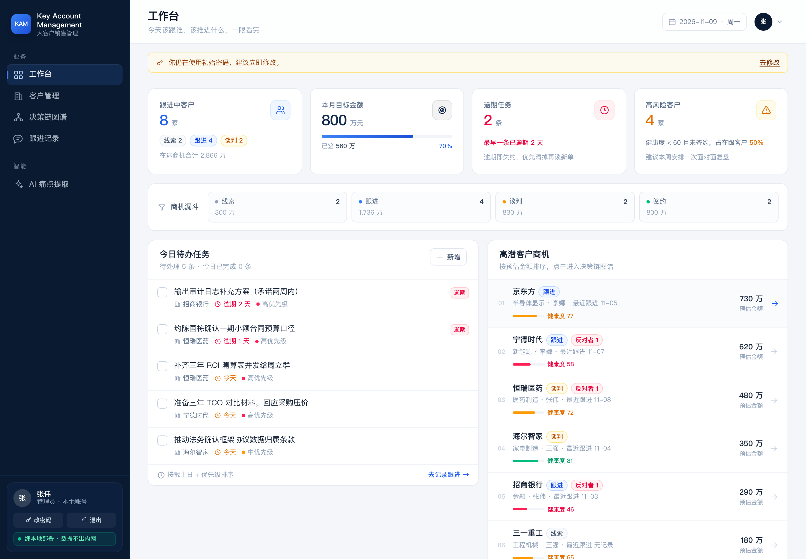
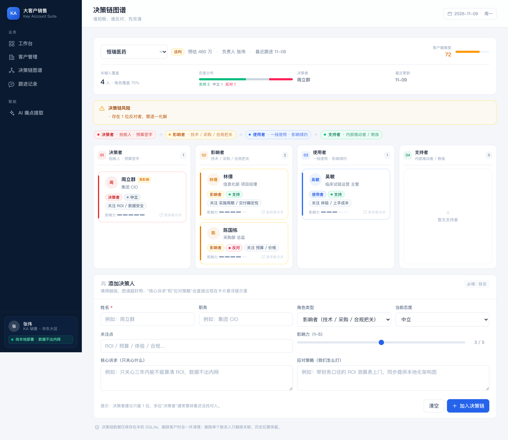
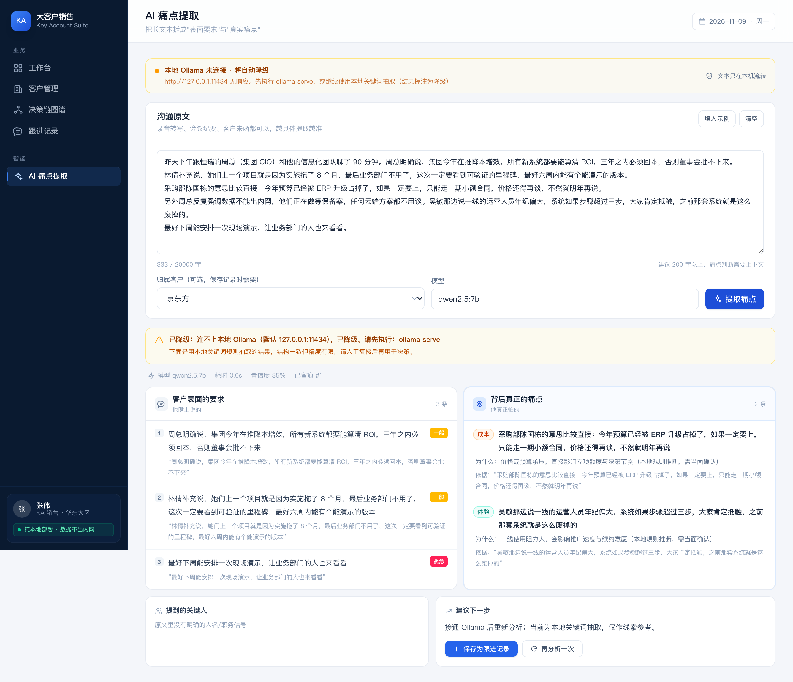
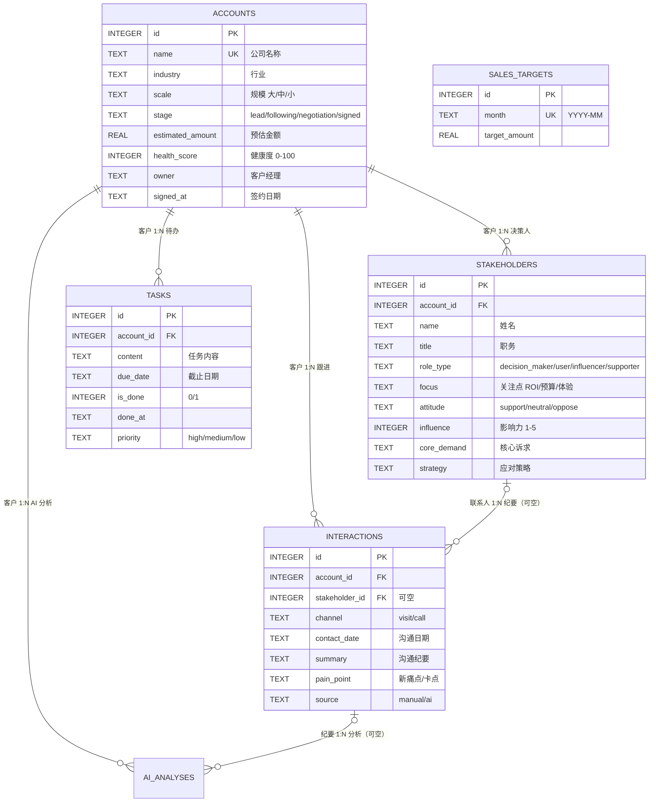
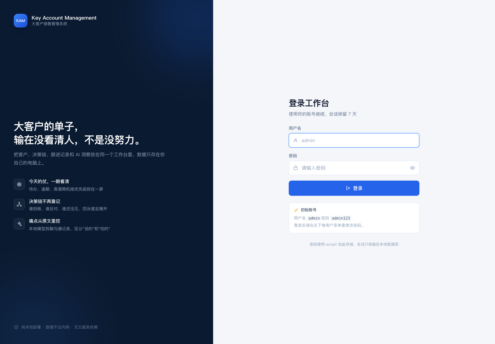
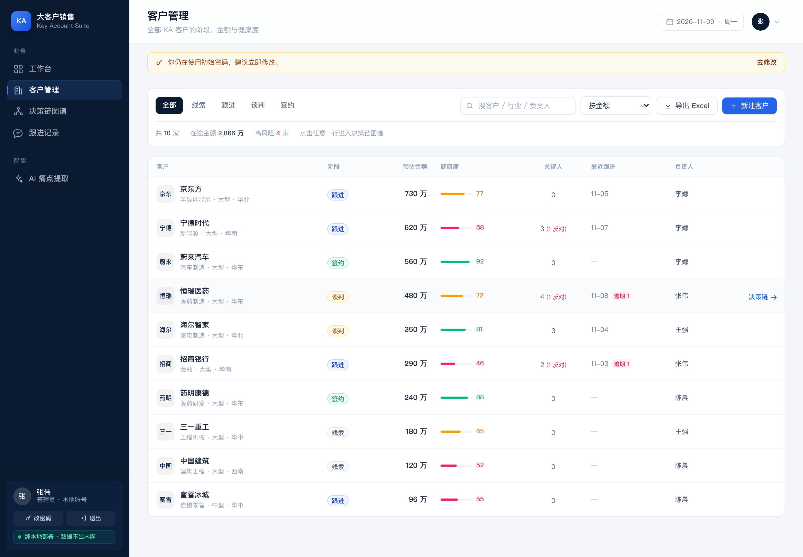
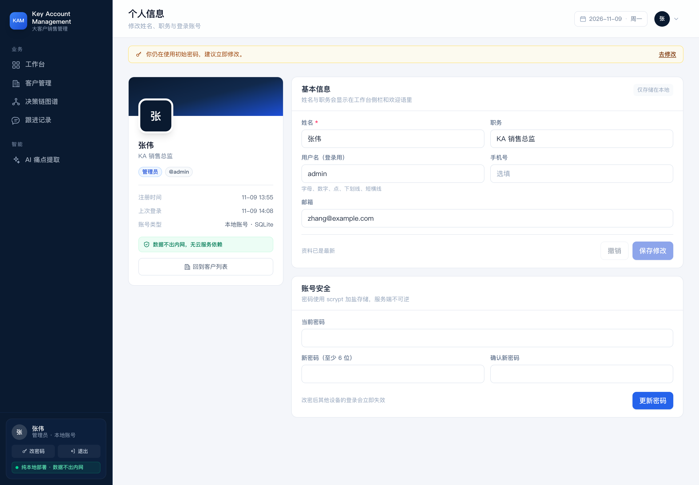

# Key Account Management · 大客户销售管理系统

[](https://github.com/florence512624/key-account-management/actions/workflows/ci.yml)


React + Express + SQLite 的纯本地部署销售工作台。核心不是"又一个 CRM 表格"，而是把三件事串起来：

1. **今天该做什么** —— 工作台把待办、逾期、高潜商机按优先级摆在一起；
2. **这单卡在谁身上** —— 决策链图谱用四泳道展示决策者/影响者/使用者/支持者，悬浮即看诉求与打法；
3. **客户到底想要什么** —— 接本地 Ollama，把沟通长文本拆成"表面要求"与"真实痛点"，模型挂了也不会白屏。

数据全部落在本机 `server/data/ka.db`，不依赖任何云服务。



<table>
  <tr>
    <td width="50%"></td>
    <td width="50%"></td>
  </tr>
</table>

---

## 快速开始

> ⚠️ 这是**本机单用户**系统：默认账号 `admin / admin123` 仅供本地演示。不要把它直接暴露到公网，详见 [CONTRIBUTING](CONTRIBUTING.md#安全)。

```bash
cd ka-sales
npm install

npm run seed          # 可选：写入演示数据（首次启动也会自动写）
npm run dev           # API :5174 + 前端 :5173
```

打开 <http://127.0.0.1:5173>，用初始账号登录：

| 用户名 | 密码 |
| --- | --- |
| `admin` | `admin123` |

登录后从左下角用户菜单改密码；也可以用 `DEFAULT_ADMIN_PASSWORD` 指定首次密码。

生产/单端口部署（Express 直接托管构建产物，一个端口跑完）：

```bash
npm run preview      # = build + start，打开 http://127.0.0.1:5174
# 或分开执行
npm run build && npm start
```

### 打不开时先看这张表

| 现象 | 原因 | 处理 |
| --- | --- | --- |
| 5174 打不开 | 只跑了 `npm run dev`（前端在 **5173**），或压根没启动 | 开发用 <http://127.0.0.1:5173>；单端口先 `npm run preview` |
| 5173 打不开 | 生产模式不监听 5173 | 用 5174 |
| 页面空白、控制台报 assets 404 | 直接双击打开了 `client/dist/index.html`（`file://`） | 必须通过 HTTP 访问，不能开本地文件 |
| 页面能开但显示「演示数据」 | API 没起，前端走了 mock 兜底 | 用 `npm run dev`（同时起 API）或 `npm run preview` |
| `EADDRINUSE` | 端口被占 | `PORT=5180 npm start` |

其他命令：

| 命令 | 作用 |
| --- | --- |
| `npm run seed:reset` | 清空业务数据并重写演示数据（日期相对"今天"生成） |
| `npm test` | 39 个测试：外键级联、脏 JSON 修复、降级、鉴权、个人资料、Excel 导出、API 契约 |
| `PORT=5180 npm start` | 换端口启动 |

环境变量见 [.env.example](.env.example)，支持 `node --env-file` 自动加载。

---

## 四步需求 → 代码落点

| 步骤 | 需求 | 落点 |
| --- | --- | --- |
| 一 | 数据库表结构与外键级联 | [`server/schema.sql`](server/schema.sql) |
| 二 | 工作台 Dashboard | [`client/src/pages/Dashboard.jsx`](client/src/pages/Dashboard.jsx) |
| 三 | 客户决策链图谱 | [`client/src/pages/StakeholderMap.jsx`](client/src/pages/StakeholderMap.jsx) + [`StakeholderCard.jsx`](client/src/components/StakeholderCard.jsx) + [`StakeholderForm.jsx`](client/src/components/StakeholderForm.jsx) |
| 四 | 本地 Ollama 痛点提取接口 | [`server/ollama.js`](server/ollama.js) + [`server/prompt.js`](server/prompt.js) + [`server/routes/ai.js`](server/routes/ai.js) |
| 扩展 | 登录与会话 | [`server/auth.js`](server/auth.js) + [`server/routes/auth.js`](server/routes/auth.js) + [`client/src/pages/Login.jsx`](client/src/pages/Login.jsx) |
| 扩展 | 客户 Excel 导出 | [`server/excel.js`](server/excel.js) + `/api/accounts/export.xlsx` |

---

## 一、数据库设计

### ER 关系



### 表与关键字段

完整 DDL 在 [server/schema.sql](server/schema.sql)（带逐字段注释，可直接执行）。六张表：

| 表 | 作用 | 关键约束 |
| --- | --- | --- |
| `accounts` | 客户主档 | `name` 唯一；`stage`/`scale` 走 CHECK 枚举；`health_score` 0–100 |
| `stakeholders` | 决策链角色 | `role_type`、`attitude` CHECK；`influence` 1–5 |
| `interactions` | 跟进记录 | `channel` 仅 visit/call；`stakeholder_id` 可空 |
| `tasks` | 待办 | `is_done` 仅 0/1；`due_date` 存 `YYYY-MM-DD` |
| `sales_targets` | 月度目标 | `month` 唯一，天然防重复配置 |
| `ai_analyses` | AI 分析留痕 | 原文 + 结果 JSON + 耗时 + 是否降级 |

### 级联策略（这是本题的重点）

| 关系 | 策略 | 为什么 |
| --- | --- | --- |
| `stakeholders.account_id → accounts.id` | `ON DELETE CASCADE` | 客户都没了，决策链就是孤儿数据 |
| `tasks.account_id → accounts.id` | `ON DELETE CASCADE` | 待办强绑定客户，不允许悬空 |
| `interactions.account_id → accounts.id` | `ON DELETE CASCADE` | 纪要属于客户档案，随客户归档 |
| `interactions.stakeholder_id → stakeholders.id` | `ON DELETE SET NULL` | **关键差异化**：换掉一个联系人，不该连带删掉三个月的沟通纪要，只把"当时找的是谁"置空 |
| `ai_analyses.account_id` | `ON DELETE CASCADE` | 分析结果依附客户 |
| `ai_analyses.interaction_id` | `ON DELETE SET NULL` | 纪要删了，分析留痕仍可复盘 |

> SQLite 的外键默认**不生效**，必须在每个连接上执行 `PRAGMA foreign_keys = ON`（见 [server/db.js](server/db.js)）。这一条没做，上面所有 CASCADE 都是装饰品——测试里专门有一条用例守着它。

### 索引、视图、触发器

- **索引**：`accounts(stage)`、`accounts(health_score)`、`stakeholders(account_id, role_type)`、`interactions(contact_date DESC)`、`tasks(is_done, due_date)` —— 覆盖看板的四个统计口径。
- **视图 `v_account_overview`**：把"关键人数 / 反对者数 / 逾期任务数 / 最近跟进日"一次算好，列表页避免 N+1，也让统计口径只有一处。
- **触发器 `trg_accounts_touch`**：只在业务字段变化时刷新 `updated_at`，避免无意义写入。

### 几个设计取舍

- **枚举存英文码，不存中文**：中文是展示层的事（[constants.js](client/src/lib/constants.js) 统一映射），否则改文案要洗数据。
- **`health_score` 存值而非实时计算**：健康度含大量人工判断（高层关系、竞争态势），不适合纯公式；但视图会暴露反对者数、逾期数等客观信号供辅助。
- **单独建 `sales_targets`**：目标按月配置、可回溯，比塞进配置表更能解释"这个月为什么是 800 万"。
- **`stage` 不带概率字段**：小团队用阶段映射概率即可，过早引入加权预测会让口径变复杂。

---

## 二、工作台 Dashboard

四张卡的口径全部落在 SQL 里，前端不做二次加工：

| 卡片 | 口径 |
| --- | --- |
| 跟进中客户 | `stage IN ('lead','following','negotiation')` 计数，副标题给出三段分布 + 在途金额 |
| 本月目标金额 | `sales_targets` 取当月目标；已签 = `stage='signed' AND signed_at 属于当月`；进度条即完成率 |
| 逾期任务 | `is_done = 0 AND due_date < 今天`，副标题给出最早逾期天数 |
| 高风险客户 | `health_score < 60 AND stage != 'signed'`，副标题给出占在跟客户的比例 |

布局：4 卡 → 商机漏斗条 → 两列（左"今日待办"，右"高潜商机"）。

- 待办带自绘勾选框，点击即乐观更新 + 回写 `done_at`，失败自动回滚并提示；
- 商机列表按预估金额排序，展示阶段、反对者数、健康度、最近跟进，点击直接进决策链图谱；
- **mock 兜底**：后端没启动时前端不白屏，而是用 [mock.js](client/src/lib/mock.js) 渲染同结构数据，并打上「演示数据」角标——既满足"先用 mock"的要求，也不会让人误认真实数据。

---

## 三、决策链图谱

- **四泳道**：决策者（红）/ 影响者（琥珀）/ 使用者（蓝）/ 支持者（绿），按角色分列，卡内显示姓名、职务、角色标签、态度标签、关注点、影响力刻度。
- **悬浮 Tooltip**：显示"核心诉求"与"应对策略"；没有内容时不是留白，而是给出可执行的追问话术（"下次沟通先问：这件事最影响您哪个指标？"）。同时支持键盘 `Tab` 聚焦触发，不只服务鼠标。
- **健康度规则**会实时算风险并在页面上明示：

| 规则 | 提示 |
| --- | --- |
| 没有决策者 | 尚未识别出决策者，成交路径不清晰 |
| 决策者态度为反对 | 一票否决风险 |
| 决策者多于 1 位 | 通常说明还没找对人，建议收敛到 1 位 |
| 存在反对者 | 需逐一化解 |
| 关键人 < 3 | 决策链过薄 |
| 没有支持者 | 缺少内部推动力量 |

- **添加表单**在页面下方：姓名必填，角色/态度有默认值，影响力用滑杆；提交后立即刷新泳道与汇总，无需整页重载。

---

## 四、本地 AI 痛点提取

`POST /api/ai/extract`，调用本机 Ollama 的 `/api/generate`（`stream: false`、`format: "json"`）。

### 请求 / 响应

```http
POST /api/ai/extract
Content-Type: application/json

{
  "text": "昨天跟恒瑞周总聊了90分钟，他说今年预算被ERP占了……",
  "model": "qwen2.5:7b",
  "accountId": 1,
  "persist": true
}
```

```jsonc
{
  "ok": true,
  "degraded": false,           // true = 走了本地规则兜底
  "model": "qwen2.5:7b",
  "latencyMs": 41230,
  "data": {
    "surface_requirements": [
      { "content": "三年内要算清 ROI", "quote": "……三年之内必须回本", "urgency": "high" }
    ],
    "real_pain_points": [
      {
        "content": "CIO 无法向董事会证明投入产出，本质是预算审批的话语权问题",
        "why": "没有财务口径，立项材料过不了董事会",
        "category": "组织",
        "quote": "否则董事会批不下来"
      }
    ],
    "stakeholder_signals": [{ "name": "周立群", "signal": "关注 ROI 与数据不出内网" }],
    "next_best_action": "带财务口径的 ROI 测算表上门，同时准备本地化部署架构图",
    "confidence": 0.78
  },
  "analysisId": 12
}
```

### 90 秒超时与降级

时间预算在 [ollama.js](server/ollama.js) 里统一管：`AbortController` 卡死总预算（默认 90s，`AI_TIMEOUT_MS` 可调），第一次尝试预留 5s 余量，只在"输出不可解析"时才用剩余时间换一版更严格的提示词重试——连不上/超时/没模型重试没有意义。

| 情况 | 行为 | 前端表现 |
| --- | --- | --- |
| 正常 | 返回模型结果 | 双栏展示，标注模型/耗时/置信度 |
| 模型输出带围栏、废话、尾逗号、中文引号 | 逐级修复后解析 | 无感知 |
| 输出仍无法解析 | 换"严格 JSON"提示词重试一次 | 无感知 |
| Ollama 未启动 / 超时 / 模型不存在 | **不返回 500**，`degraded: true` + 本地关键词抽取 | 琥珀色横幅说明原因，结果标注"仅供线索参考" |
| 文本过短（< 20 字） | 400 + 校验详情 | 表单内联报错 |

降级结果的结构与模型结果**完全一致**，所以前端只有一套渲染分支；差异只在 `degraded`、`message` 和置信度（本地规则固定 0.35）。

### 让模型别"换个说法重复一遍"

提示词里写死了判定标准与反例（[prompt.js](server/prompt.js)）：

> 客户说"你们报价太高"。
> ✗ 错误痛点："客户觉得价格高"（这是复述表面要求）。
> ✓ 正确痛点："采购部今年预算已被其他系统占用，压价是为了把项目挤进剩余额度，本质是预算窗口问题"。

并要求每条结论带 `quote` 原文依据、没有证据就返回空数组，压低小模型的编造率。

### 准备 Ollama

```bash
ollama serve
ollama pull qwen2.5:7b      # 或 llama3.1:8b
curl localhost:11434/api/tags
```

页面顶部有连接状态灯；`GET /api/ai/health` 会返回可达性、模型列表和超时配置。

---

## 五、登录与会话



纯本地部署不代表不要登录——同事借用电脑、投屏演示时，客户名单不该裸奔。

- **密码**：`scrypt` 加盐派生（`N=16384, r=8, p=1`），库里只存 `scrypt$N$r$p$salt$hash`，比较用 `timingSafeEqual`；
- **会话**：随机 32 字节 token 写进 `HttpOnly; SameSite=Lax` Cookie，数据库只存它的 SHA-256，**泄库也换不出可用凭据**；
- **有效期**：7 天，过期自动清理；改密码会吊销其他设备会话，当前会话保留；
- **防爆破**：同一 IP + 用户名连续 5 次失败，锁定 10 分钟，提示还剩几次（测试里覆盖了"不泄露账号是否存在"）；
- **前端**：`AuthProvider` 统一持有登录态，任意接口 401 会派发事件把页面切回 `/login`，并记住原地址、登录后原路返回。

```bash
# 首次启动日志里会打印
[auth] 已创建初始账号 admin（密码为默认值 admin123，请登录后修改）
```

> 没有做"角色权限"的差异化：`users.role` 已落库（admin / sales），但当前两种角色看到的页面一样。多人协作场景再补。

## 六、客户台账 Excel 导出



`GET /api/accounts/export.xlsx`，**所见即所得**：当前页面的阶段筛选、关键词、排序会原样带进导出，导出的行数就是屏幕上的行数。

导出的不是 CSV 改后缀，是真正的 `.xlsx`（exceljs 生成），拿到就能进周会：

- **客户明细**：16 列，冻结前 3 行、自动筛选、金额千分位、阶段色块、健康度 < 60 标红、末尾合计行；
- **商机汇总**：阶段分布、健康度分布、负责人商机排行，均带金额与占比；
- 文件名带日期（`KA客户台账-20261109.xlsx`），`Content-Disposition` 同时给 ASCII 兜底与 RFC 5987 中文名，WPS / Excel / Numbers 都不会乱码。

```bash
# 命令行验证（需先登录拿 Cookie）
curl -c /tmp/ka.txt -X POST localhost:5174/api/auth/login \
  -H 'Content-Type: application/json' -d '{"username":"admin","password":"admin123"}'
curl -b /tmp/ka.txt -o ~/Desktop/ka.xlsx localhost:5174/api/accounts/export.xlsx?stage=negotiation
```

---

## 七、个人信息



左下角用户卡或右上角头像菜单 → **个人信息**（`/profile`）。

可改：姓名、职务、邮箱、手机号、登录用户名；不可改：角色（需要管理员在库里调整）。

- **姓名即时生效**：保存后侧栏、头像首字母、欢迎语立刻更新，不用重登；
- **改用户名要谨慎**：唯一性校验不区分大小写（`Admin` 与 `admin` 视为同一个），改完下次登录要用新用户名，当前会话不受影响；
- **改密码独立成卡**：和弹窗共用同一个 `PasswordForm` 组件，校验逻辑不会两处跑偏。

> 老库升级会自动补 `users.title / email / phone` 三列（`db.js` 里的 `ensureColumn`），不用手动迁移。

---

## API 一览

| 方法 | 路径 | 说明 |
| --- | --- | --- |
| POST | `/api/auth/login` | 登录，下发 HttpOnly 会话 Cookie |
| POST | `/api/auth/logout` | 退出并吊销当前会话 |
| GET | `/api/auth/me` | 当前登录用户（未登录 401） |
| PATCH | `/api/auth/profile` | 修改姓名/职务/邮箱/手机号/登录用户名 |
| PATCH | `/api/auth/password` | 修改密码，吊销其它设备会话 |
| GET | `/api/accounts/export.xlsx` | 按当前筛选导出 Excel（明细 + 汇总两页） |
| GET | `/api/health` | 服务与数据量自检 |
| GET | `/api/dashboard` | 四卡 + 漏斗 + 今日待办 + 高潜商机 |
| GET | `/api/accounts?stage=&q=&sort=` | 客户列表（带汇总） |
| GET/POST | `/api/accounts` | 列表 / 新建 |
| GET/PATCH/DELETE | `/api/accounts/:id` | 客户全家桶 / 更新 / 删除（级联） |
| GET/POST | `/api/accounts/:id/stakeholders` | 决策链列表（含健康度汇总）/ 新增 |
| PATCH/DELETE | `/api/stakeholders/:id` | 更新 / 删除 |
| GET/POST | `/api/accounts/:id/interactions` | 跟进记录 / 新增 |
| DELETE | `/api/interactions/:id` | 删除 |
| GET/POST | `/api/tasks` | 待办（`scope=today\|overdue\|open\|done`） |
| PATCH/DELETE | `/api/tasks/:id` | 勾选 / 编辑 / 删除 |
| GET | `/api/ai/health` | Ollama 可达性与模型列表 |
| POST | `/api/ai/extract` | 痛点提取（含降级） |
| GET | `/api/ai/analyses` | 分析留痕 |

请求校验用 zod，错误统一返回 `{ error, details[] }`；`details` 直接给到字段级原因，前端原样展示。

---

## 目录结构

```
ka-sales/
├── server/
│   ├── schema.sql        # 建表 DDL（第一步交付物）
│   ├── db.js             # 连接、PRAGMA、日期工具
│   ├── seed.js           # 演示数据（日期相对今天）
│   ├── app.js            # Express 装配 + 静态托管 + 错误出口
│   ├── index.js          # 启动入口
│   ├── ollama.js         # 调用、超时、JSON 修复、降级
│   ├── prompt.js         # 抽取提示词
│   └── routes/           # dashboard / accounts / stakeholders / interactions / tasks / ai
├── client/
│   ├── src/pages/        # 工作台 / 客户 / 决策链 / 跟进 / AI
│   ├── src/components/   # Layout、StatCard、StakeholderCard/Form、ui 基础件
│   └── src/lib/          # api 封装、枚举映射、格式化、mock
└── test/                 # db / ai / api 三组测试
```

---

## 测试

```bash
npm test
# 28 pass / 0 fail
```

- `test/db.test.js`：外键开关真的打开了吗、删除客户是否级联、删联系人是否只置空、CHECK 是否拦住非法枚举、视图口径、触发器；
- `test/ai.test.js`：围栏/废话/尾逗号/中文引号的 JSON 修复、字段别名归一、本地规则抽取、连不上 Ollama 时是否 `degraded` 而非抛错；
- `test/api.test.js`：真实 HTTP 服务上的**未登录 401 / 错误密码不泄露账号 / Cookie 属性 / 登录后鉴权**、看板字段、筛选搜索、创建/重名/校验、决策链汇总变化、待办勾选、级联删除、**Excel 导出（反向用 exceljs 读回校验表结构与筛选生效）**、AI 降级留痕、改密后旧密码失效、登出即失效、404 契约。

---

## 开源协议

[MIT](LICENSE) © 2026 florence512624。

选 MIT 而不是 AGPL：这是个"拿走改成自己公司内部工具"的产品，限制越少越有用；如果哪天要做成 SaaS，再考虑换协议。

## 参与贡献

欢迎 issue 与 PR，动手前请先看 [CONTRIBUTING.md](CONTRIBUTING.md)：里面有本地启动方式、测试要求（改行为就补测试）、代码风格（不写分号、注释写"为什么"）和 PR 清单。

需要练手的点：

- 客户详情页（跟进时间线 + 待办 + 商机进展合并到一屏）
- 角色权限差异（`users.role` 已落库，但 admin / sales 目前看到的一样）
- 图谱支持拖拽布局与汇报线

---

## 已知边界

- **单账号起底**：登录与个人资料已做，但没有注册、找回密码、角色差异化权限；多人协作需要再补。
- **导出是同步生成**：几千行以内没问题，十万行级建议改成流式或后台任务。
- **无迁移框架**：`schema.sql` 是幂等 DDL，后续改表建议引入版本表或 `PRAGMA user_version` 迁移。
- **图谱是泳道布局**，不是可拖拽的关系画布；决策链层级（汇报线）目前靠角色与影响力表达。
- **未做附件与录音上传**：当前只接受转写后的文本，音频需外部工具先转文字。
- **Ollama 在 CPU 上较慢**：7B 模型处理 3k 字文本通常 30–70s，属正常区间；追求速度可换 `qwen2.5:3b` 并下调 `num_ctx`。
